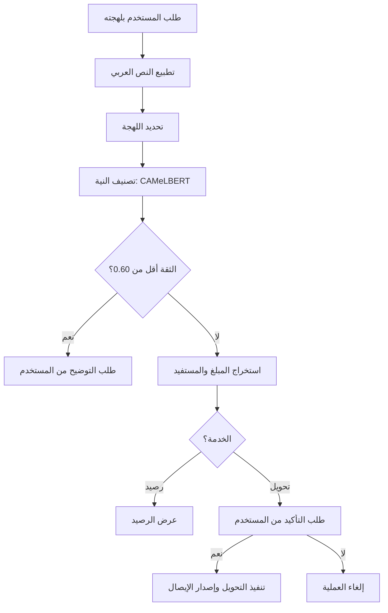

# 🎙️ لهجتي | Lahjti
مشروع «لهجتي» بالتعاون مع @SDAIA في برنامج معالجة اللغات التطبيقية
**لهجتي** مساعد ذكي في البنوك يستقبل طلب العميل نصًا أو صوتًا بلهجته المحلية (النجدية، الحجازية، القصيمية، إضافة إلى الفصحى)، فيفهم نيّته أولًا، ثم ينفّذ الخدمة المطلوبة، كالاستعلام عن الرصيد أو التحويل، بعد تأكيد صريح منه. (يغطي النموذج الأولي الإدخال النصي؛ انظر «حدود المشروع».)

يوضح المشروع كيف يمكن دمج نموذج لغوي مضبوط (Fine-tuned) مع قواعد استخراج المعلومات وخطوة تأكيد بشرية، لبناء مساعد يخدم من يصعب عليهم استخدام التطبيقات البنكية التقليدية.

> **تنبيه:** الحساب والأرصدة والمستفيدون **بيانات وهمية** لأغراض تعليمية، ولا يوجد أي ربط ببنك حقيقي.

---

## 🌐 جرّب المساعد مباشرة

**الرابط:** https://almudayani-kadi.github.io/lahjti-Banking-assistant/

- يعمل مباشرة داخل المتصفح دون تسجيل أو تثبيت.
- أول تحميل للنموذج قد يستغرق نحو دقيقة، ثم يعمل بسرعة.
- أمثلة للتجربة: «وش رصيدي الحين»، «ابي احول لأبوي خمسمية»، «أبغى أحول لأخوي تلتمية».

يمكن أيضًا تشغيل النسخة الكاملة (واجهة Gradio) من الدفتر `lahjti.ipynb` في Google Colab.

---

## 🚀 نظرة عامة على المشروع

يقسم المشروع العمل إلى مرحلتين:

| المرحلة | الوصف |
|---|---|
| **1. Listen & Understand** | تحديد اللهجة، وتصنيف نية الطلب، واستخراج التفاصيل (المبلغ والمستفيد). |
| **2. Execute** | تنفيذ الطلب على حساب تجريبي: الاستعلام عن الرصيد، أو التحويل بعد تأكيد صريح من المستخدم. |التقييم الصادق:** مجموعة اختبار مستقلة، وفترة ثقة بالمعاودة (Bootstrap)، وتحليل منهجي للأخطاء.

---

## 👥 الفئة المستهدفة

لا يستطيع جميع الأشخاص استخدام التطبيقات البنكية بسهولة، وخاصة:

- كبار السن.
- ذوو الإعاقة والاحتياجات الخاصة.
- من يجدون صعوبة في التعامل مع التقنية.
- من يفضّلون التعبير عن طلباتهم بلهجتهم المحلية.

---

## ⚙️ كيف يعمل

---

## 🧰 التقنيات المستخدمة

| الجانب | الأداة |
|---|---|
| تصنيف النية | CAMeLBERT-DA (`CAMeL-Lab/bert-base-arabic-camelbert-da`): 10 حقب، دفعة 4، معدل تعلم 3e-5 |
| تطبيع النص | إزالة التشكيل والتطويل، وتوحيد الألف والياء والتاء المربوطة |
| تحديد اللهجة | قاموس كلمات لكل لهجة |
| إخفاء البيانات الحساسة | أرقام الجوال والبطاقات (Regex) |
| استخراج المبلغ والمستفيد | قواعد تدعم الأرقام والمبالغ بالحروف (خمسمية، تلتمية، ألف) |
| البحث الدلالي (نموذج أولي) | Sentence Transformers + FAISS + Cross-Encoder |
| واجهة الدفتر | Gradio |
| النسخة الدائمة على الويب | تحويل النموذج إلى ONNX وتشغيله داخل المتصفح بـ Transformers.js، واستضافته على GitHub Pages |
| استضافة النموذج | [Hugging Face Hub](https://huggingface.co/kadi4655/lahjti-intent) |

> البحث الدلالي موجود في الدفتر بوصفه نموذجًا أوليًا، **وغير مدمج** في العرض التجريبي.

---

## 📊 البيانات

| المجموعة | عدد الجمل | الوصف |
|---|---|---|
| التدريب | 144 | جمل بنكية قصيرة مكتوبة يدويًا: 4 أنماط لغوية (نجدي، حجازي، قصيمي، فصحى) × 6 نيات × 6 جمل |
| الاختبار المستقل | 42 | صياغات مختلفة عن التدريب ولم تُستخدم فيه أبدًا: 12 جملة لكل لهجة، و6 للفصحى |

النيات الست: `balance` (الرصيد)، `transfer` (التحويل)، `expenses` (المصروفات)، `block_card` (إيقاف البطاقة)، `fees` (الرسوم)، `out_of_scope` (خارج النطاق).

---

## 📈 النتائج

التقييم على مجموعة الاختبار المستقلة (42 جملة):

| المقياس | القيمة |
|---|---|
| الدقة الكلية | **0.929** (39 من 42) |
| فترة الثقة 95% (Bootstrap) | 0.83 – 1.00 |
| Macro-F1 | **0.93** |
| الدقة: النجدي | 0.833 |
| الدقة: الحجازي | 1.000 |
| الدقة: القصيمي | 0.917 |
| الدقة: الفصحى | 1.000 |

> عند التقييم على جزء مقتطع من بيانات التدريب نفسها (48 جملة) كانت النتيجة 1.0، لكن هذه الصياغات متشابهة مع التدريب، لذلك نعتمد نتيجة الاختبار المستقل بوصفها الأقرب للواقع. وبما أن الاختبار صغير (42 جملة)، فإن الفرق بين لهجة وأخرى بجملة واحدة قد لا يكون ذا دلالة، وتعكس فترة الثقة هذا الهامش.

### 🔍 تحليل الأخطاء

أخطأ النموذج في 3 جمل من 42 (اثنتان نجديتان وواحدة قصيمية)، وكلها صُنّفت `expenses`، وتعود إلى نمطين واضحين:

1. **الخلط بين الرصيد والمصروفات (جملتان):** «وش اللي باقي لي من الفلوس» (نجدي) و«كم بقى لي من الفلوس» (قصيمي) صُنّفتا `expenses` بدل `balance`، بسبب كثرة كلمة «الفلوس» في جمل المصروفات.
2. **إيقاف البطاقة بصيغة «اقفل» (جملة واحدة):** «ابي اقفل البطاقة اللي ضاعت» (نجدي) صُنّفت `expenses` بدل `block_card`، لأن بيانات التدريب تستخدم «وقّف» و«سكّر» ولا تحتوي «اقفل».

**الإصلاح المقترح:** إضافة جمل تدريب تغطي هذه الصياغات، ولم يُنفَّذ بعد.

---

---

## 🔮 العمل المستقبلي

- **دعم الإنجليزية:** باستخدام نموذج متعدد اللغات مثل `xlm-roberta-base`، مع بيانات تدريب واختبار إنجليزية للنيات نفسها.
- **الإدخال الصوتي:** إضافة تعرّف على الصوت (Speech-to-Text) ليكتمل مفهوم «يستمع ثم يفهم».
- **توسيع البيانات:** زيادة عدد الجمل، وإضافة جمل جمعها متحدثون حقيقيون من كل لهجة، وتغطية لهجات سعودية أخرى.
- **معالجة أنماط الخطأ المرصودة:** إضافة صياغات مثل «اقفل البطاقة» و«باقي لي من الفلوس» إلى بيانات التدريب.

---

## ▶️ طريقة التشغيل

**الخيار الأول: النسخة على الويب**
افتح رابط المساعد في أعلى الصفحة.

**الخيار الثاني: الدفتر في Google Colab**
1. افتح `lahjti.ipynb` في Google Colab.
2. ارفع ملف البيانات `lahjti data_full.xlsx` وملف الاختبار `test_set.xlsx` إلى بيئة Colab.
3. شغّل الخلايا بالترتيب (Run all). التدريب يستغرق بضع دقائق.
4. شغّل خلية العرض التجريبي، وافتح الرابط الذي يظهر (`gradio.live`).

---

## 📁 هيكل المستودع

| الملف | الوصف |
|---|---|
| `index.html` | النسخة الدائمة من العرض التجريبي (تعمل داخل المتصفح) |
| `lahjti.ipynb` | الشيفرة الكاملة: التطبيع، تحديد اللهجة، التدريب، البحث، التقييم، العرض التجريبي |
| `lahjti data_full.xlsx` | بيانات التدريب |
| `test_set.xlsx` | بيانات الاختبار المستقل |

---

## 👩‍💻 الإعداد

**كادي المضياني** — مشروع نهائي لمقرر معالجة اللغات التطبيقية (NLP).
